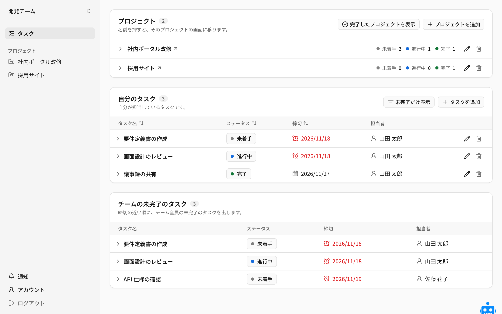
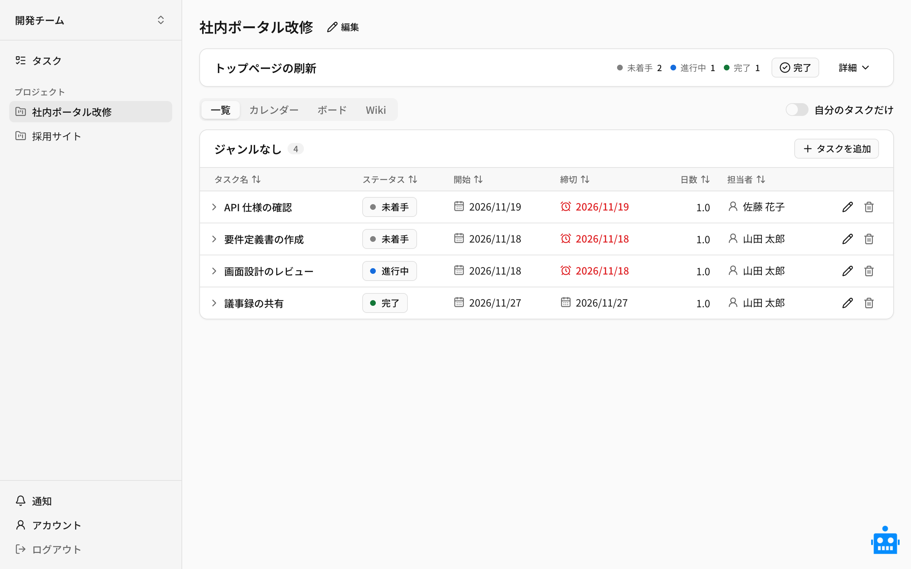
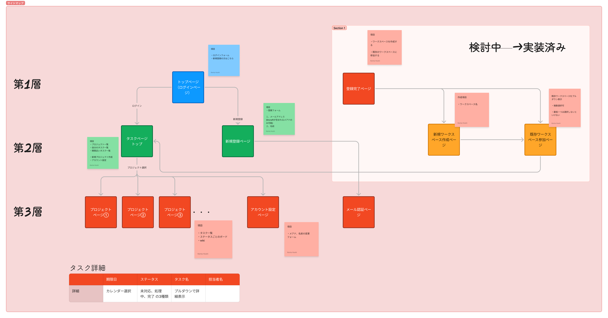

# タスクマネージャー

チームのタスクと進捗を、スプレッドシートの代わりに管理する Web アプリです。
プロジェクトを小プロジェクトとタスクに分け、担当者・締切・実績の工数・コメント・添付・Wiki をまとめて扱えます。





画面の人名とプロジェクト名は見本です。

## 開発の背景

現場の業務管理はスプレッドシートやワード、エクセルが中心で、入力の書式や更新のルールが緩く、タスクの状況を正確につかめていませんでした。
サブリーダーとして「管理の手間を減らし、開発に集中できる環境を作りたい」と考え、このアプリを作りました。

## 主な機能

| 機能 | 説明 |
|------|------|
| ワークスペース | チームごとにワークスペースを作り、合言葉で参加する。データはメンバーにだけ見える |
| プロジェクトとタスク | プロジェクト → 小プロジェクト → タスクの3段で管理する。担当者・締切・ジャンル・実績の工数を記録できる |
| 表示の切り替え | プロジェクトのタスクを、一覧・ボード（ドラッグでステータスを変える）・カレンダーで表示する |
| タスク画面 | 自分のタスクと、チームの未完了のタスクを並べて表示する。列ごとに並べ替えられる |
| コメント・添付 | タスクごとにコメントを書き、ファイルを添付できる |
| Wiki | プロジェクトごとに Markdown で資料を書ける |
| 通知 | 担当の変更・コメント・期限（2日前・前日・当日）などを、アプリ内の通知一覧に出す |
| AI に質問 | Gemini API に質問し、答えを Markdown で表示する |
| アカウント | 登録・ログイン・名前とパスワードの変更（Supabase Auth） |

## 使用技術

| レイヤー | 技術 |
|---------|------|
| フロントエンド | Next.js 16（App Router）、React 19、TypeScript |
| 画面の部品 | Tailwind CSS v4、shadcn/ui（Radix UI）、lucide-react、dnd-kit（並べ替え） |
| DB・認証・ファイル | Supabase（PostgreSQL・Auth・Storage） |
| AI | Gemini API（gemini-2.5-flash） |
| デプロイ | Vercel（DB の自動停止を防ぐ Cron を含む） |
| テスト | Jest、React Testing Library |

## 設計の要点

### データの取得と更新

- 画面はクライアント部品として作り、Supabase へ画面から直接問い合わせる
- マウスとキーの操作が15分途絶えたら、画面のデータを読み直す。別のタブから戻ったときも、15分以上たっていれば読み直す（`app/hooks/getDataUpdate.ts`）。リアルタイムの購読は使っていない
- サーバーで動くのは、Gemini を呼ぶ API と、DB を起こす API の2つだけ（`app/api/`）

### 権限は DB の側で守る

画面から DB へ直接問い合わせるので、権限は Supabase の RLS（行ごとのアクセス制御）で守ります。

- 同じワークスペースのメンバーだけが、そのデータを読み書きできる
- users の行で本人が変えられるのは名前だけ。メールは登録のときに決まり、あとから書き換えられない（列ごとの権限）
- ワークスペースの作成と参加は、DB の関数（RPC）からだけできる。参加には合言葉が要る
- タスクの担当者・通知の宛先は、そのワークスペースのメンバーに限る
- ログインしていない人には、表も関数も渡さない（DB を起こす関数を除く。返すのは件数だけ）
- 登録できるメールのドメインは、画面に加えて、Supabase の登録前フック（Before User Created）でも確かめる。API を直接呼んでも、許していないドメインではユーザーが作られない

表・RLS・関数はすべて `supabase/schema.sql` にあり、`supabase/tests/rls.sql` で3人のユーザーになりすまして37項目を確かめます。登録前フックは `supabase/tests/signup_hook.sql` で14項目を確かめます。

### Gemini の鍵はサーバーの外に出さない

`/api/sendGeminiMessage` は Supabase のアクセストークンを確かめ、ログインしている人だけが呼べます。
API キーはサーバーの環境変数から読み、URL ではなくヘッダーで送ります。

### Wiki の HTML は危ないタグを落としてから描く

Wiki は Markdown の中の HTML を通します。ただし `rehype-sanitize` で `script` や `iframe` を落としてから描きます。
AI の答えは HTML を通しません。

### テスト

Jest のテストは435件あります。

- `test/lib/`：日付・通知・並べ替え・ステータス・DB の問い合わせの関数
- `test/components/`：タスク画面の表・ポップアップ・AI チャット・通知・コメント、共通部品、プロジェクト画面の枠・一覧・カレンダー・ボード・Wiki、ワークスペースの作成・参加・設定、アカウント
- `test/top/`・`test/register/`：ログインと登録の流れ
- `test/api/`：DB を起こす API

部品を分ける前に今の動きをテストで固定し、テストを変えずに部品を分けました（PR #6・#7）。

## 2024年版と2026年版の違い

最初の版（2024年）はタグ `v1-original` に残しています。2026年に、公開に向けて次の手直しをしました。

| 目的 | 中身 | PR |
|------|------|----|
| 公開できる形にする | 特定の会社名を消し、登録できるメールのドメインを環境変数で決める | #2 |
| 依存を整理する | 使っていないライブラリ15個を外す | #3 |
| 画面の側の穴を塞ぐ | Wiki と AI チャットの HTML、ログイン確認の無かった Gemini の API、URL で渡していた userId、条件の無い select | #4 |
| 権限を DB で守る | ほぼ全表が「ログインした人なら全行を読み書きできる」だった RLS を、ワークスペースのメンバー単位に作り直す | #5 |
| 動きを固定する | テストを46件から109件に増やす | #6 |
| 重複をまとめる | 3か所に重複していたタスクの詳細の行と実績の処理を、共通の部品とフックにまとめる（3,767行 → 2,277行） | #7 |
| デモを止めない | 無料プランの Supabase が7日で自動停止しないよう、Vercel Cron で毎日 DB に問い合わせる | #8 |
| 土台を新しくする | Next.js 16・React 19 へ上げ、supabase-js を最新にし、使っていない `@supabase/ssr` を外す | #10・#11 |
| 画面を作り直す | CSS Modules（39ファイル）と英語の文言を、Tailwind CSS・shadcn/ui と日本語に置き換える。サイドバーの枠に全画面をまとめ、操作できる要素をボタンかリンクにしてキーボードでも使えるようにする。画面ごとに、見た目の PR と不具合の PR に分けた | #12〜#32 |

## 既知の問題

手直しの中で見つけ、まだ直していないものです。

### 動きの不具合

- 保存の処理が複数の書き込みに分かれていて、途中で失敗したときの巻き戻しが一部だけ
- 画面の読み直しの途中に別の保存が終わると、その保存のあとの読み直しが起きず、古い表示が残ることがある（全画面の作り）。ボードで続けてカードを動かしたときも同じ
- タスク・プロジェクトのポップアップと実績の入力は、日付を現地の9時として送るので、UTC+10 より東では前日になる
- カレンダーの期間・ステータスとボードの移動は、ほかの人が先にタスクを消して更新が0件でも、成功として扱う
- アカウントを自分では削除できない。消すときは管理者が Supabase の管理画面から消す

### 権限と入力の確認

- ワークスペース名の重複の確認は全ワークスペースが対象で、名前を変えるときは確かめない
- メンバーなら誰でも、ほかのメンバーをワークスペースから外せる（役割の区別がない）
- 画面にメールの変更は無いが、Supabase の API で認証のメールを直接変えると、users 表のメールは古いまま残る（そろえるトリガーが無い）

## セットアップ

必要なもの：Node.js 22、Supabase のプロジェクト（無料プランで動く）、Gemini の API キー（AI に質問する機能を使うときだけ）

1. Supabase の SQL Editor で `supabase/schema.sql` を1回実行する。空のプロジェクトに、表・RLS・関数・ストレージがそろう。2026-11-26 より前の `schema.sql` で作った DB では、権限の節の users の3行（`revoke update` から `revoke insert, delete` まで）を追加で実行する
2. `.env.example` を `.env.local` に写し、値を入れる

   | 変数 | 値 |
   |------|----|
   | `NEXT_PUBLIC_SUPABASE_URL` | Supabase の Project URL |
   | `NEXT_PUBLIC_SUPABASE_ANON_KEY` | Supabase の anon の鍵 |
   | `GEMINI_API_KEY` | Gemini の API キー |
   | `NEXT_PUBLIC_ALLOWED_EMAIL_DOMAIN` | 登録できるメールのドメイン（例：`example.com`）。空なら絞らない |

3. Supabase のダッシュボードの Authentication > Providers > Email で、パスワードの最短の長さを 8、必要な文字を「Letters and digits」にする（画面の規則と同じ条件を、API を直接呼ばれたときにもかける）
4. 登録できるメールのドメインを絞るときは、次の2つを行う（絞らないなら不要）。すでに動いている DB に足すときは、`schema.sql` のうち「登録できるメールのドメイン」の節（表・関数・revoke と grant）だけを SQL Editor で実行してから行う
   - Supabase のダッシュボードの Authentication > Hooks で、Before User Created に `public.hook_restrict_signup_by_email_domain` を選んで有効にする
   - SQL Editor で、許すドメインを小文字で入れる：`insert into private.signup_allowed_domains (domain) values ('example.com');`。環境変数 `NEXT_PUBLIC_ALLOWED_EMAIL_DOMAIN` にも同じドメインを入れる（画面は送る前に知らせ、DB は送られたあとに止める）
5. 起動する

   ```bash
   npm install
   npm run dev
   ```

テストは `npm test` で動きます。RLS と登録前フックを確かめるときは、`supabase/tests/rls.sql` と `supabase/tests/signup_hook.sql` を SQL Editor で実行します（最後に取り消すので、データは残りません）。

## サイトマップ


